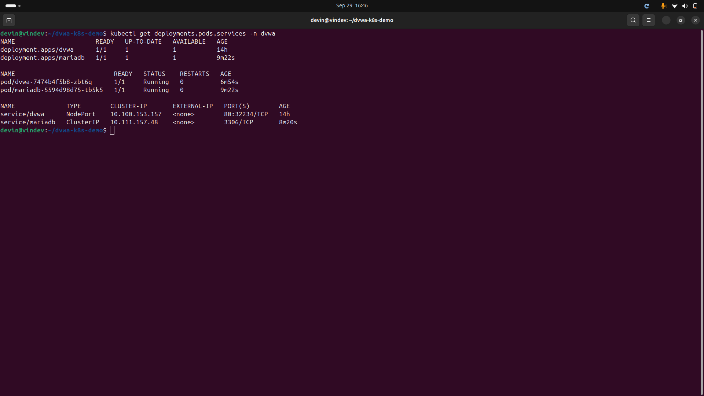
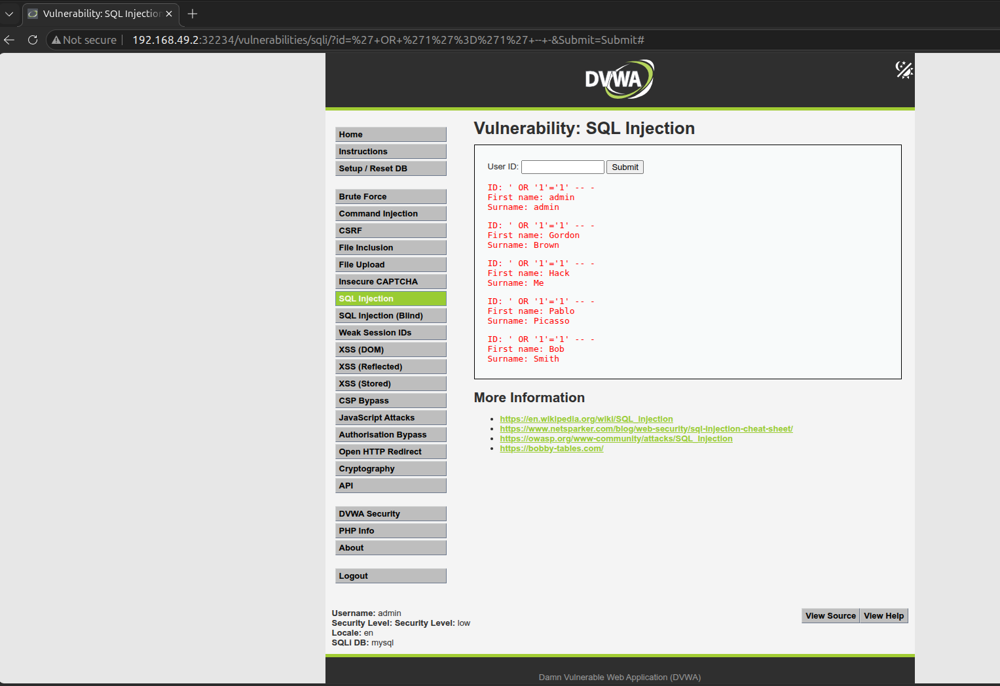
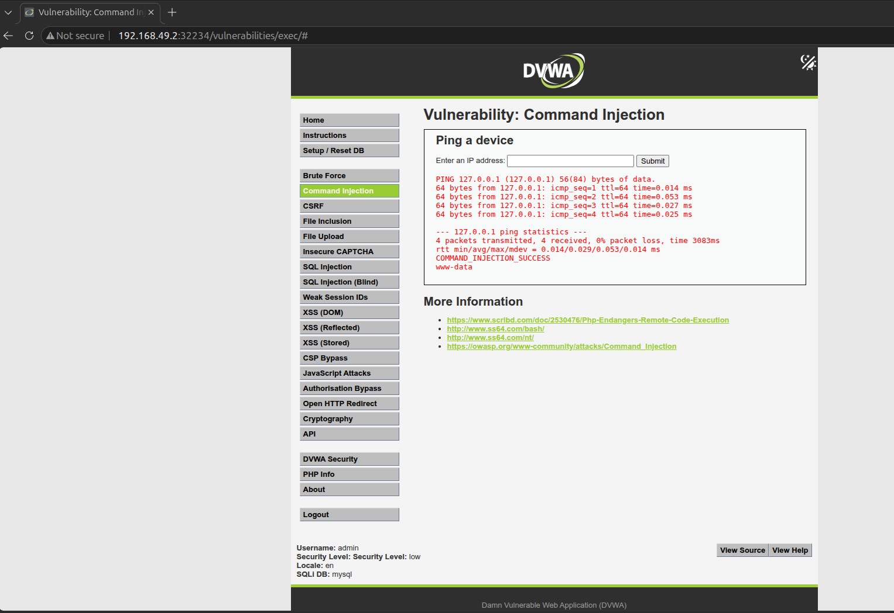
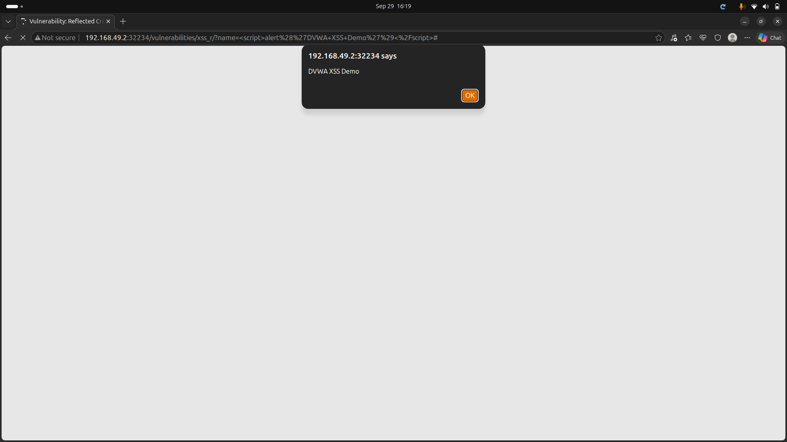

# DVWA on Kubernetes

Local deployment of **Damn Vulnerable Web Application (DVWA)** on Kubernetes using Minikube, followed by demonstrations of three web application vulnerabilities.


## Architecture

```text
Browser
   |
   v
DVWA NodePort Service
   |
   v
DVWA Pod
   |
   | DB_SERVER=mariadb
   v
MariaDB ClusterIP Service
   |
   v
MariaDB Pod
```

## Stack

- Ubuntu 24.04 LTS
- Docker
- Minikube
- Kubernetes
- DVWA: `ghcr.io/digininja/dvwa:latest`
- MariaDB: `mariadb:10`

## Deployment

Start the cluster:

```bash
minikube start --driver=docker
kubectl create namespace dvwa
```

Deploy MariaDB:

```bash
kubectl apply -f k8s/mariadb-secret.yaml
kubectl apply -f k8s/mariadb.yaml
kubectl apply -f k8s/mariadb-service.yaml
```

Deploy DVWA:

```bash
kubectl apply -f k8s/dvwa.yaml
kubectl apply -f k8s/dvwa-service.yaml
```

Verify:

```bash
kubectl get deployments,pods,services -n dvwa
```



Access DVWA:

```bash
minikube service dvwa -n dvwa --url
```

For a fresh deployment, initialize the database using **Setup DVWA → Create / Reset Database**.

---

## Attack Demonstrations

### 1. SQL Injection

Demonstrated manipulation of an application's database query through unsafe user input handling.

**Result:** The application returned database information beyond the intended user lookup.

**Mitigation:** Parameterized queries, input validation, and least-privilege database access.



### 2. Command Injection

Demonstrated unsafe handling of user input passed to an operating-system command.

**Result:** Additional command input was interpreted by the underlying shell.

**Mitigation:** Avoid shell execution with user input, use safe APIs, and apply strict allow-list validation.



### 3. Reflected XSS

Demonstrated unsafe reflection of user-controlled input into an HTML response.

**Result:** A harmless JavaScript test payload executed in the browser.

**Mitigation:** Context-aware output encoding, safe templating, input validation, and Content Security Policy.



---

## Project Structure

```text
.
├── README.md
├── k8s/
│   ├── dvwa.yaml
│   ├── dvwa-service.yaml
│   ├── mariadb.yaml
│   ├── mariadb-service.yaml
│   └── mariadb-secret.yaml
└── screenshots/
```

## Status

- [x] Local Kubernetes cluster
- [x] DVWA + MariaDB deployment
- [x] SQL Injection demo
- [x] Command Injection demo
- [x] Reflected XSS demo

## Security Notice

DVWA is intentionally vulnerable. This deployment is intended only for isolated, authorized security testing and should not be exposed to the public internet.
